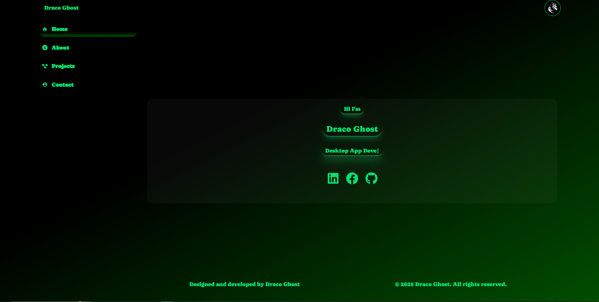

# Draco Ghost's Developer portfolio

Welcome to my personal portfolio website - a showcase of my work, skills, and passions as a developer and a creator.

🔗 [Live Site](https://draco-ghost-portfolio.42web.io/)

---



---

## 🛠️ Tech Stack

This project is built with:

- **PHP** — Server-side scripting and dynamic page rendering
- **HTML5** — Website structure
- **Tailwind CSS** — for fast and responsive styling
- **CSS** — Styling and responsive layouts
- **Javascript** — Client-side interactivity
- **XAMPP** — Local development environment with Apache

---

## 🚀 Getting Started

Follow these steps to run the project locally.

## Prerequisites

Make sure you have installed
- XAMPP
- Git

## installation

1. Clone the repository

```bash
git clone https://github.com/draco-ghost/portfolio.git
```

2. Move the project into XAMPP's htdocs directory

For a standard Windows installation, copy or move the project folder to:

```text
C:\xampp\htdocs\portfolio
```

3. Start Apache
Open the XAMPP Control Panel and start the Apache module.

If the project uses a database, also start MySQL and configure the required database settings.

4. Open the website

Visit the following URL in your browser

```text
http://localhost/portfolio/
```

## 📁 Project Structure

The project ma contain the following files and directories, depending on its current implementation:

```text
portfolio/
├── index.php
├── assets/
│   ├── css/
│   ├── js/
│   └── images/
├── includes/
├── LICENSE
└── README.md
```

---

## 💻 Development

- Edit PHP, HTML, CSS, and JavaScript files in your preferred code editor.
- Keep the project inside XAMPP's htdocs directory for local development.
- Refresh your browser to see your changes.
- Access PHP files through Apache using localhost; opening them directly as files in your browser will not execute PHP.

---

## 📝 License
This project is licensed under the [GNU General Public License v3.0](./LICENSE)
Please credit this repository if you use or modify any of the source code, in accordance with the applicable license terms.
